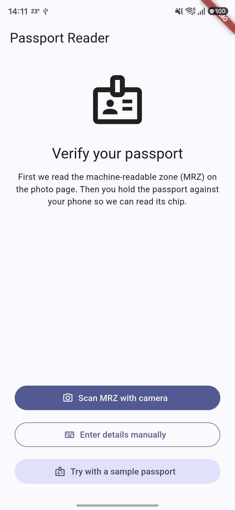
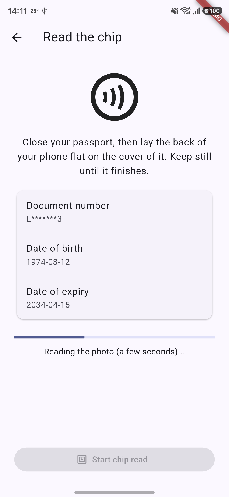
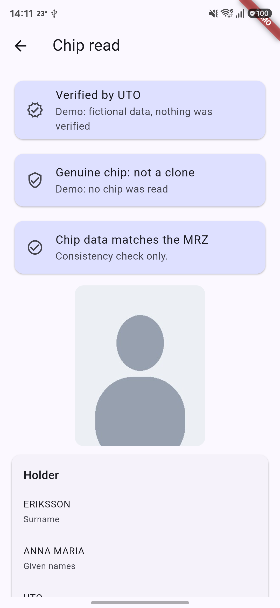

# passport_reader

A cross-platform (Android/iOS) Flutter app that reads an ePassport's chip over NFC and verifies it, plus a Python server that checks the passport's digital signatures against the issuing country's certificates.

> ⚠️ **Educational project, not a production identity-verification system.**
> It was built step by step as a learning exercise in Flutter, NFC and PKI.
> It is **not affiliated with, endorsed by, or connected to** any government agency or passport authority. See [Known limitations](#known-limitations) before reusing any of it.

## What it does

1. **Scans the MRZ** (the two `<<<` lines on the photo page) with the camera, using on-device OCR, and validates every ICAO 9303 check digit.
2. **Unlocks the chip** over NFC with **PACE** when supported, falling back to **BAC**, using a key derived from the MRZ.
3. **Reads the small files first**: DG1 (holder's details), DG14/DG15 when present, and the **SOD** (the issuing country's signature over all data group hashes).
4. **Checks the chip isn't a clone (Chip Authentication)**: proves the chip holds the private key matching DG14's public key, and switches to new session keys derived from that exchange.
5. **Reads the photo (DG2) last**, because it's the largest file. After a successful Chip Authentication it is read over the new session in 223-byte chunks (the largest that fits a short APDU with both 3DES and AES), with every response MAC-checked. Otherwise, or if that read fails, the app falls back to `dmrtd`'s slower adaptive read.
6. **Decodes the photo**, including **JPEG2000**, with a pure-Dart decoder running in a background isolate.
7. **Verifies authenticity (Passive Authentication)** on the server: SOD signature → Document Signer certificate → trusted CSCA (from a master list whose own signature is verified against a pinned root) → data group hashes, plus optional CRL revocation checks.
8. **Verifies the photo on the phone.** The photo is **never uploaded**: the app hashes DG2 locally and compares it with the hash the issuing country signed, which the server returns only after verifying the whole chain.
9. **Proves the request comes from the genuine app** (Android): each request carries a **Google Play Integrity** token bound to the exact request body, which the server can log or enforce.

```text
Phone (Flutter)                                     Server (Python / FastAPI)
───────────────                                     ─────────────────────────
Camera ─▶ MRZ ─▶ NFC (PACE/BAC) ─▶ DG1, DG14/15, SOD
               ─▶ Chip Authentication ─▶ DG2 (photo)
SOD + DG1 (+ DG14/15)  ── POST /v1/passive-auth ────▶ Play Integrity token (optional),
  + X-Integrity-Token     (HTTPS, pinned CA)          CMS signature, certificate chain,
                                                      validity, revocation, DG hashes
                       ◀── verdict + signed hashes ──
SHA(DG2) == signed DG2 hash?  → photo verified on-device
```

## Screenshots

|                                                          Home                                                          |                                                  Chip read                                                   |                                                Result                                                |
| :--------------------------------------------------------------------------------------------------------------------: | :----------------------------------------------------------------------------------------------------------: | :--------------------------------------------------------------------------------------------------: |
|  |  |  |
|                      Scan the MRZ with the camera, enter it by hand, or try the sample passport.                       |                     The document number is masked while the app reads the chip over NFC.                     |          Verification, anti-cloning and MRZ consistency checks, plus the holder's details.           |

_All screenshots come from the demo build and use the ICAO 9303 specimen passport. No real data is shown._

## Repository layout

```text
lib/
  core/            Logic with no UI: MRZ parsing, chip reading, Chip Authentication,
                   image decoding, verification client, pinned TLS, device integrity,
                   privacy cover, background timeout, demo services. Unit-tested.
  features/        Screens: home, MRZ scan, manual entry, NFC read, result.
android/           Android host app: `real` and `demo` product flavors, the Play
                   Integrity method channel and screen protection (MainActivity.kt).
ios/               iOS host app (compile-checked only, see Known limitations).
test/              Flutter tests (ICAO sample passport and synthetic data only).
tool/              make_test_certs.sh: throwaway TLS fixtures for the tests.
scripts/           dev_adb_reverse.sh: forwards the phone's port 8000 to the computer.
                   release_local.sh: tag, deploy and install a release (author's setup).
backend/
  app/             FastAPI server: Passive Authentication, trust store, CRLs,
                   Play Integrity checks, configuration.
  tests/           Pytest suite using fictional countries generated with OpenSSL.
  tools/           crl_urls.py: lists a country's CRL download addresses.
  scripts/         checkpoint.sh: one-command health check of the backend.
                   dev_pki.sh: development CA and localhost TLS certificate.
                   prod_pki.sh: offline production CAs and server certificates.
                   refresh_crls.sh: downloads the CRLs listed in crl_sources.txt.
  anchors/         Pinned root certificate(s) trusted to sign master lists.
.github/           CI workflow and Dependabot configuration.
codemagic.yaml     Cloud iOS builds (no Mac required).
```

## Requirements

| Part   | Needs                                                                                                                     |
| ------ | ------------------------------------------------------------------------------------------------------------------------- |
| App    | Flutter 3.50 (stable, the version CI uses), an **NFC-capable Android phone** (Android 7+ / API 24+). Emulators have no NFC. |
| iOS    | iPhone 7 or newer, iOS 15.5+. Building needs a cloud Mac (Codemagic); installing needs a paid Apple Developer membership. |
| Server | [uv](https://docs.astral.sh/uv/), Python 3.14 (installed by uv), OpenSSL (used by the tests).                             |

Developed entirely on Windows with WSL; no Mac was used.

## Running the server

```bash
cd backend
uv python install 3.14
uv sync                       # creates .venv from uv.lock
uv run pytest -v              # all tests use fictional countries
```

### Trust anchors and master lists

The server only trusts CSCA certificates that come from a **master list whose signature it has verified**:

1. Download the root certificate of the master-list publisher (for example Germany's CSCA from the BSI website), **check its SHA-256 fingerprint against the value published on the official page**, and put it in `backend/anchors/`.

   ```bash
   openssl x509 -inform DER -in anchors/<file>.cer -noout -subject -fingerprint -sha256
   ```

2. Download the matching master list (`.ml`) into `backend/trust/`. Plain CSCA certificates (`.pem`, `.der`, `.cer`, `.crt`) placed in `trust/` are trusted as they are, without any signature check.

3. Optionally add CRLs to `backend/crls/`. `uv run python -m tools.crl_urls ES` lists a country's CRL addresses. `./scripts/refresh_crls.sh` downloads every CRL listed in `crl_sources.txt` and keeps the previous file if a download fails or has expired.

`trust/` and `crls/` are git-ignored: master lists and PKD data come with their own terms of use, so download them yourself.

### Development TLS certificate

The app only talks HTTPS, and only to servers whose certificate chains to a CA pinned in `lib/core/network/pinned_cas.dart`. For local development, create a private CA and a `localhost` certificate:

```bash
./scripts/dev_pki.sh          # creates pki/ca.pem once; re-run to renew pki/server.pem
```

The CA is created once per machine. On a new machine, paste the new `pki/ca.pem` into `_developmentCas` in `pinned_cas.dart`. Development CAs are trusted by debug builds only, never by release builds. `pki/` is git-ignored; never commit `ca.key`.

The script works in WSL, Linux, macOS and Git Bash on Windows.

### Start it

```bash
./scripts/checkpoint.sh       # environment, tests, trust store and /health in one go
TRUST_DIR=trust uv run uvicorn app.main:app --host 127.0.0.1 --port 8000 \
  --ssl-keyfile pki/server.key --ssl-certfile pki/server.pem
```

`checkpoint.sh` also checks that Spain (`ES`) is in the trust store, so that check fails until a master list containing Spain is installed. For a full walkthrough from a fresh clone to a phone talking to the server, see [Local development server](#local-development-server).

### Configuration

| Variable                        | Default   | Meaning                                                                                     |
| ------------------------------- | --------- | ------------------------------------------------------------------------------------------- |
| `TRUST_DIR`                     | `trust`   | Master lists and CSCA certificates                                                          |
| `ML_ANCHORS_DIR`                | `anchors` | Roots trusted to sign master lists                                                          |
| `CRL_DIR`                       | `crls`    | Certificate revocation lists                                                                |
| `REQUIRE_CRL`                   | off       | `1` = fail when a CRL is missing or out of date (fail closed)                               |
| `ALLOW_UNVERIFIED_MASTER_LISTS` | off       | `1` = accept master lists without checking their signature (not recommended)                |
| `INTEGRITY_MODE`                | `off`     | Play Integrity: `off`, `report` (check and log, never block) or `enforce` (reject with 403) |
| `PLAY_INTEGRITY_SA_FILE`        | (none)    | Google service-account JSON used to decode tokens. Required unless `INTEGRITY_MODE=off`     |
| `REQUIRE_PLAY_RECOGNIZED`       | off       | `1` = also require the app to be the build distributed by Google Play                       |
| `APP_ENV`                       | (none)    | `production` = refuse to start unless CRLs are required, master lists are verified and Play Integrity is on |

### Play Integrity (optional)

1. Link a Google Cloud project to the app in the Play Console and enable the **Play Integrity API**.
2. Create a service account with access to the API, download its JSON key into `backend/secrets/` (git-ignored), and point `PLAY_INTEGRITY_SA_FILE` at it.
3. Run the app with `--dart-define=PLAY_CLOUD_PROJECT_NUMBER=<number>`. Without it, the app sends no token.

The server checks that the token is for this app's package, is less than 2 minutes old, matches the SHA-256 of the request body, and reports `MEETS_DEVICE_INTEGRITY`. Start with `report` and read the logs before switching to `enforce`.

The server logs verification **outcomes only**, never names, numbers or raw data. Integrity logs contain verdict labels only.

## Local development server

This walkthrough takes a fresh clone to a phone that reads a passport and has it verified by a server on your own computer. Everything runs locally: no cloud services are needed, and Play Integrity stays off.

```text
Phone ──USB/Wi-Fi adb──▶ adb reverse tcp:8000 ──▶ https://localhost:8000 (uvicorn on your computer)
```

### 1. Install the tools

- [uv](https://docs.astral.sh/uv/), OpenSSL and `curl` for the server.
- Flutter 3.50 and the Android platform tools (`adb`) for the app.

### 2. Set up the Python environment

```bash
cd backend
uv python install 3.14
uv sync                       # creates .venv from uv.lock
uv run pytest -q              # optional: should report all tests passing
```

### 3. Create the trust store folders

The server **refuses to start if `trust/` does not exist**, so create it even if it stays empty for now:

```bash
mkdir -p trust crls
```

With an empty `trust/` the server starts and answers, but every passport fails with _"Document Signer was not issued by any trusted CSCA"_. That's enough to test the app-to-server connection. To verify real passports, install a root certificate and master list as described in [Trust anchors and master lists](#trust-anchors-and-master-lists).

If `trust/` contains a `.ml` file but `anchors/` has no matching root, the server stops with `MasterListError`. That's deliberate. Fix the anchor rather than setting `ALLOW_UNVERIFIED_MASTER_LISTS=1`.

### 4. Create the development TLS certificate and pin it in the app

```bash
./scripts/dev_pki.sh          # writes pki/ca.pem, pki/server.key, pki/server.pem
```

The app trusts only the CAs listed in `lib/core/network/pinned_cas.dart`. **The first time you run the script on a machine**, copy the full contents of `backend/pki/ca.pem` (including the `BEGIN`/`END` lines) into `_developmentCas`. Debug builds trust that list; release builds never do.

The server certificate is valid for 397 days, for `localhost` and `127.0.0.1` only. Re-run the script to renew it; the CA stays the same, so the app doesn't need to change.

### 5. Start the server

```bash
TRUST_DIR=trust uv run uvicorn app.main:app --host 127.0.0.1 --port 8000 \
  --ssl-keyfile pki/server.key --ssl-certfile pki/server.pem
```

At start-up the server logs how many CSCA certificates and CRLs it loaded, plus a warning for each development-only setting (unverified master lists, `REQUIRE_CRL` off, integrity not enforced). Those warnings are expected locally.

Check it from a second terminal, at the repository root:

```bash
curl --cacert backend/pki/ca.pem https://localhost:8000/health
# {"status":"ok","cscaCertificates":0,"countries":0,"crls":0}
```

Passing `--cacert` instead of `-k` checks the same chain the app will check. `uv run uvicorn ... --reload` restarts the server automatically when the code changes.

### 6. Connect the phone and run the app

```bash
adb devices                   # the phone must be listed as "device"
scripts/dev_adb_reverse.sh    # the phone's localhost:8000 now reaches your computer
flutter run --flavor real --dart-define=VERIFY_URL=https://localhost:8000
```

`--flavor` is required, because the Android project defines two product flavors: `real` and `demo`. Re-run `scripts/dev_adb_reverse.sh` every time the phone reconnects, because adb forwarding doesn't survive a disconnect.

The server binds to `127.0.0.1`, so nothing else on your network can reach it; `adb reverse` is the only way in. `https://localhost:8000` is also the app's default `VERIFY_URL`, so the `--dart-define` only documents the value here.

### 7. Optional: test Play Integrity locally

Follow [Play Integrity (optional)](#play-integrity-optional), then start the server in report mode so that it logs verdicts but never blocks a request:

```bash
INTEGRITY_MODE=report PLAY_INTEGRITY_SA_FILE=secrets/play-integrity.json \
TRUST_DIR=trust uv run uvicorn app.main:app --host 127.0.0.1 --port 8000 \
  --ssl-keyfile pki/server.key --ssl-certfile pki/server.pem
```

Then add `--dart-define=PLAY_CLOUD_PROJECT_NUMBER=<number>` to `flutter run`.

### Troubleshooting

| Symptom | Likely cause |
| --- | --- |
| `FileNotFoundError: ... 'trust'` at start-up | The `trust/` folder is missing (step 3), or the server was started outside `backend/`. |
| `MasterListError` at start-up | A `.ml` file in `trust/` isn't signed by a certificate in `anchors/`. |
| App: _"Couldn't establish a trusted connection"_ | `pki/ca.pem` isn't in `_developmentCas`, the server certificate has expired, or you're running a release build. |
| App: _"Couldn't reach the verification server"_ | The server isn't running, or `adb reverse` was lost: re-run `scripts/dev_adb_reverse.sh`. |
| App: _"The verification server refused the request"_ (HTTP 422) | The request was malformed or too large; the server log lists the field names, never their values. |
| Every passport: _"not issued by any trusted CSCA"_ | `trust/` is empty or doesn't contain the issuing country. |
| WSL: the phone can't reach a server that works from WSL | `adb` runs on Windows but the server is in WSL. Run both on the same side, or check that WSL forwards `localhost` (the default with WSL 2). |

### No server at all: the demo build

```bash
flutter run --flavor demo
```

The demo app has its own package name (`.demo`) and allows screenshots. It never touches NFC or the network: it always shows the ICAO specimen passport and says in the result that nothing was verified.

## Running the app

```bash
flutter pub get
tool/make_test_certs.sh       # TLS fixtures the tests need (not committed)
flutter test

# Phone connected (USB or wireless debugging), server running locally with TLS:
scripts/dev_adb_reverse.sh
flutter run --flavor real --dart-define=VERIFY_URL=https://localhost:8000 \
  --dart-define=PLAY_CLOUD_PROJECT_NUMBER=<number>   # optional
```

- The verification URL **must use `https://`**: the client refuses anything else, in every build mode.
- **Wireless debugging from WSL:** `adb pair <ip:port>`, then `adb connect <ip:port>`. Re-run `scripts/dev_adb_reverse.sh` after reconnecting.
- **Reading the chip:** remove thick or metal cases, open the passport at the photo page (some passports keep the chip in the cover), and hold the phone still until the read finishes.

## iOS builds without a Mac

`codemagic.yaml` contains two workflows:

- **`ios-compile-check`**: an unsigned build that confirms the iOS project compiles. It works on Codemagic's free tier.
- **`ios-testflight`**: a signed build uploaded to TestFlight. It needs a paid Apple Developer membership, an App ID with **NFC Tag Reading** enabled, and an App Store Connect API key. **Never commit the `.p8` key.**

## Continuous integration

GitHub Actions (`.github/workflows/ci.yml`) runs on every push to `main` and every pull request:

- **No secrets in the repository**: fails if key material (`.p8`, `.p12`, `.jks`, `.key`, Play Integrity JSON, …) is tracked by git.
- **Flutter tests**: `dart format` check, `flutter analyze`, test certificates, `flutter test`.
- **Backend tests**: `uv sync --locked` and `pytest`.
- **Android build**: Gradle wrapper validation and debug APK builds of both flavors (`real` and `demo`).

Dependabot keeps the backend's Python dependencies and the workflow's GitHub Actions up to date.

## Security model

- **Authenticity is decided on the server**, never on the phone. The app's "Verified" badge is display only; a real system would act on the server's verdict.
- **The connection is pinned**: the app accepts only certificates issued by its own CAs (`pinned_cas.dart`), not the device's trust store. Debug and release builds pin different CAs.
- **Device integrity (Android)**: requests can carry a Play Integrity token bound to the SHA-256 of the exact request body, so a token can't be reused for another request. The app never decides what a missing token means; the server does (`INTEGRITY_MODE`).
- **Screen protection**: screenshots and screen recording are blocked (`FLAG_SECURE`), other apps' overlay windows are hidden on Android 12+ (anti-tapjacking), and the app-switcher snapshot shows a neutral cover instead of passport data.
- **No keyboard learning**: the manual MRZ entry fields disable suggestions, autocorrect and personalised keyboard learning, so passport numbers and dates aren't stored by the keyboard.
- **Anti-cloning on the chip**: Chip Authentication proves the chip holds DG14's private key. Explicit curve parameters are accepted only when they exactly match a known curve.
- **The photo is read strictly**: under the Chip Authentication keys, every READ BINARY must return data that passes the MAC check, with no silent retry or recovery. The file's length header is checked before any further reads, and files over 32 KB are refused.
- **Untrusted input is parsed defensively**: strict ASN.1 parsing, size limits on every field, memory-safe decoders, and one clear failure type per layer.
- **Minimum data leaves the phone**: SOD, DG1 and DG14/DG15 only. **DG2 (the face) is verified on-device.** Fingerprint and iris groups (DG3/DG4) are inaccessible to the app and refused by the server.
- **Secure defaults**: unverified master lists are refused, explicit-parameter EC keys are accepted only when they exactly match a vetted curve, and weak settings are announced at server start-up.
- **Passport data on the phone** is kept in memory only, byte buffers are zeroed when the result screen closes (best effort in a garbage-collected language), the photo is kept out of Flutter's global image cache, and camera frames are never written to disk.

## Known limitations

**Scope**
- Verifies that a passport document and its chip are genuine. It does **not** verify that the person holding it is its owner (no face matching or liveness detection).
- Educational project. Not affiliated with, or endorsed by, any government agency or passport authority.

**Chip access and authenticity**
- PACE falls back to BAC on chips whose `EF.CardAccess` dmrtd cannot parse; BAC keys derive only from the MRZ, so anyone who has seen the data page can read the chip.
- Chip Authentication is performed and reported by the app, not verified by the server. It proves a genuine chip is responding but cannot detect NFC relay attacks.
- Active Authentication (DG15) is not implemented.
- 6 CSCAs from the German master list (AT, AE, JP) are skipped because of encoding errors; each of those countries has other valid CSCAs.
- CRLs are configured for Spain only; other countries are verified without revocation data.

**Platforms**
- iOS is compile-checked only and has never run on a device.
- iOS cannot block screenshots; its app-switcher cover is not guaranteed to be drawn in time.
- Device integrity (Play Integrity) runs in report mode: it is not enforced until iOS App Attest exists, because a check one platform skips can be bypassed by claiming to be that platform. Integrity verdicts raise the cost of attacks; they do not make them impossible.

**Data handling**
- Passport bytes are erased on exit and after 2 minutes in the background, but Dart strings (name, document number) cannot be erased and may persist until garbage-collected.
- Keyboard privacy flags are requests a malicious keyboard can ignore; prefer the camera scan.
- On-device text recognition (Google ML Kit) sends anonymous usage telemetry to Google; images and recognised text stay on the device.
- A public deployment would process personal data (DG1) and fall under the GDPR.

## Testing without personal data

All tests use either the **ICAO 9303 specimen passport** (`L898902C3`, "ANNA MARIA ERIKSSON") or **fictional countries** generated on the fly with OpenSSL ("Utopia", "Neverland", "Explicitland"). No real passport data is, or should ever be, committed to this repository. Please don't open issues containing MRZ lines, chip dumps or screenshots of real documents.

## Third-party components and licences

- [`dmrtd`](https://github.com/ZeroPass/dmrtd): ePassport chip access (BAC/PACE, data groups). **LGPL** (or a commercial licence). Distributing an app built with it carries LGPL obligations.
- [`j2k`](https://pub.dev/packages/j2k): pure-Dart JPEG 2000 decoder.
- [Google ML Kit text recognition](https://pub.dev/packages/google_mlkit_text_recognition): on-device OCR.
- `camera`, `http`, `crypto`: Flutter/Dart packages.
- [Play Integrity API](https://developer.android.com/google/play/integrity) (`com.google.android.play:integrity`): device and app attestation on Android.
- Server: FastAPI, uvicorn, `asn1crypto`, `cryptography`, `google-auth` (to decode Play Integrity tokens).
- Master lists and PKD data (BSI, ICAO) are **not included** and are subject to their publishers' terms.

## Licence

The code in this repository is released under the MIT License. See [LICENSE](LICENSE).
Third-party components keep their own licences (see above).
